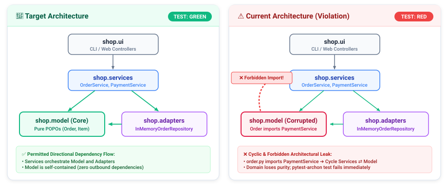

# Architecture Fitness Functions with Python & pytest-archon

This repository contains a self-contained demonstration of automated architectural fitness functions in Python using [pytest-archon](https://github.com/jwbargsten/pytest-archon).

It demonstrates how package dependencies and architectural boundaries can be enforced directly in unit tests and automated CI pipelines, serving as the Python counterpart to Java's well-known [ArchUnit](https://www.archunit.org/).

---

## 🏛️ Architecture Overview

The demo follows a Clean Architecture / Onion Architecture package layout under `src/shop`:

```
src/
└── shop/
    ├── model/         <-- Core Domain Entities (Pure POPOs)
    │   └── order.py
    ├── adapters/      <-- Secondary / Infrastructure Adapters (Database, external APIs)
    │   └── repository.py
    ├── services/      <-- Application Business Services / Orchestration
    │   ├── order_service.py
    │   └── payment.py
    └── ui/            <-- Entry points / CLI / Web Controllers
        └── cli.py
```

### 🎯 SOLL vs. ⚠️ IST Architecture



### Architectural Rules Enforced by Tests:

1. **Pure Data Model (`shop.model`):**
   - The `model` namespace defines domain entities and data structures (`Order`, `OrderItem`).
   - It **MUST NOT** import anything from `shop.services`, `shop.adapters`, or `shop.ui`.
2. **Asymmetric Dependency Flow:**
   - `shop.services` contains application business logic and orchestration, and **MAY** import `shop.model` and `shop.adapters`.
   - `shop.model` and `shop.adapters` **MUST NOT** import `shop.services` (prevents cyclic dependencies and architectural leakage).
3. **UI Isolation (`shop.ui`):**
   - `shop.ui` may call `services` and `model`.
   - Backend layers (`model`, `services`, `adapters`) **MUST NEVER** depend on `shop.ui`.

---

## 🚀 Quickstart

### 1. Prerequisites & Virtual Environment

Python 3.9+ is required.

```bash
# Clone the repository and navigate into it
cd python-archunit-demo

# Create and activate a virtual environment
python3 -m venv .venv
source .venv/bin/activate

# Install dependencies (pytest & pytest-archon)
pip install -r requirements.txt
```

### 2. Run the Architectural Fitness Tests (All Green 🟢)

```bash
pytest
```

Output:
```text
tests/test_architecture.py::test_model_must_not_depend_on_other_packages PASSED [ 25%]
tests/test_architecture.py::test_services_may_use_model_but_model_cannot_use_services PASSED [ 50%]
tests/test_architecture.py::test_services_may_use_adapters_but_adapters_cannot_use_services PASSED [ 75%]
tests/test_architecture.py::test_ui_isolation PASSED                     [100%]

============================== 4 passed in 0.01s ===============================
```

---

## 🔴 Live Classroom Demos: Step-by-Step Architecture Violations

The demo is structured so you can demonstrate violations **one by one without confusing students**:

```
Demo Flow:
  1. Base State       ➔ 3 Passed, 1 Skipped (Green)
  2. Demo 1 (Model)   ➔ ONLY test_model_must_not_depend_on_other_packages FAILS (Red)
  3. Demo 2 (UI Leak) ➔ ONLY test_ui_isolation FAILS (Red)
  4. Demo 3 (Transit) ➔ Shows why 'adapters' transitively breaks when 'model' is dirty
```

### 🔹 Demo 1: Pure Data Model Violation (`shop.model` ➔ `shop.services`)
1. Open [`src/shop/model/order.py`](src/shop/model/order.py).
2. Uncomment line 19:
   ```python
   from shop.services.payment import PaymentService  # ❌ FORBIDDEN DEPENDENCY!
   ```
3. Run `pytest`.
   - **Result:** **ONLY 1 test fails:** `test_model_must_not_depend_on_other_packages`.
   - **Takeaway:** The data model must not directly import application services.
4. Comment line 19 out again.

### 🔹 Demo 2: UI Layer Leakage (`shop.services` ➔ `shop.ui`)
1. Open [`src/shop/services/order_service.py`](src/shop/services/order_service.py).
2. Uncomment line 19:
   ```python
   from shop.ui.cli import run_cli_checkout_demo  # ❌ FORBIDDEN UI LEAK!
   ```
3. Run `pytest`.
   - **Result:** **ONLY 1 test fails:** `test_ui_isolation`.
   - **Takeaway:** Backend logic must never depend directly on user interfaces.
4. Comment line 19 out again.

### 🔹 Demo 3: Direct vs. Transitive Dependency Leakage
*Why is isolating the data model so crucial?*

1. Uncomment line 19 in `src/shop/model/order.py` again.
2. Run `pytest`:
   - `test_adapters_must_not_depend_directly_on_services` still **PASSES** (because `adapters` has no direct import to `services`).
3. Now run the transitive test explicitly:
   ```bash
   pytest -k "test_transitive_dependency_leakage"
   ```
   - **Result:** It **FAILS** with the full transitive import path:
     ```text
     from shop.adapters.repository ↣ shop.model.order ↣ shop.services.payment
     ```
   - **Key Lesson for Students:** A bad import in a fundamental layer (`model`) transitively infects every module that uses that layer (`adapters`)!

---

## 🔍 How the Fitness Functions are Written

In [`tests/test_architecture.py`](tests/test_architecture.py):

```python
from pytest_archon import archrule

def test_model_must_not_depend_on_other_packages():
    """Domain model must remain pure."""
    (
        archrule("pure_domain_model")
        .match("shop.model*")
        .should_not_import("shop.services*")
        .should_not_import("shop.adapters*")
        .should_not_import("shop.ui*")
        .check("shop")
    )

def test_services_may_use_model_but_model_cannot_use_services():
    """Asymmetric dependency: services can call model, but model cannot call services."""
    (
        archrule("model_cannot_depend_on_services")
        .match("shop.model*")
        .should_not_import("shop.services*")
        .check("shop")
    )
```

---

## 🔄 CI/CD Integration

Because `pytest-archon` integrates directly into standard `pytest`, you can add it to any GitHub Actions / GitLab CI pipeline as a build gate:

```yaml
# .github/workflows/architecture.yml
name: Architecture Fitness Functions
on: [push, pull_request]

jobs:
  arch-tests:
    runs-on: ubuntu-latest
    steps:
      - uses: actions/checkout@v4
      - uses: actions/setup-python@v5
        with:
          python-version: '3.11'
      - run: pip install -r requirements.txt
      - run: pytest tests/test_architecture.py
```

